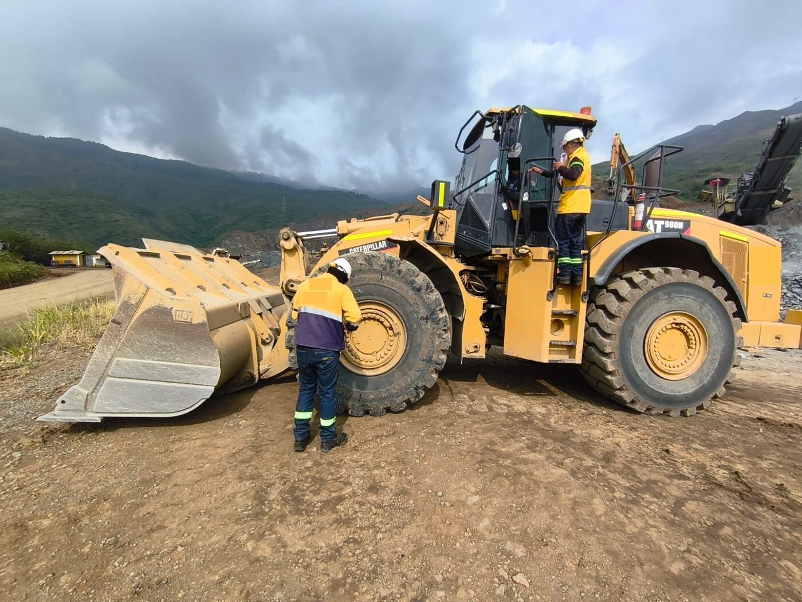
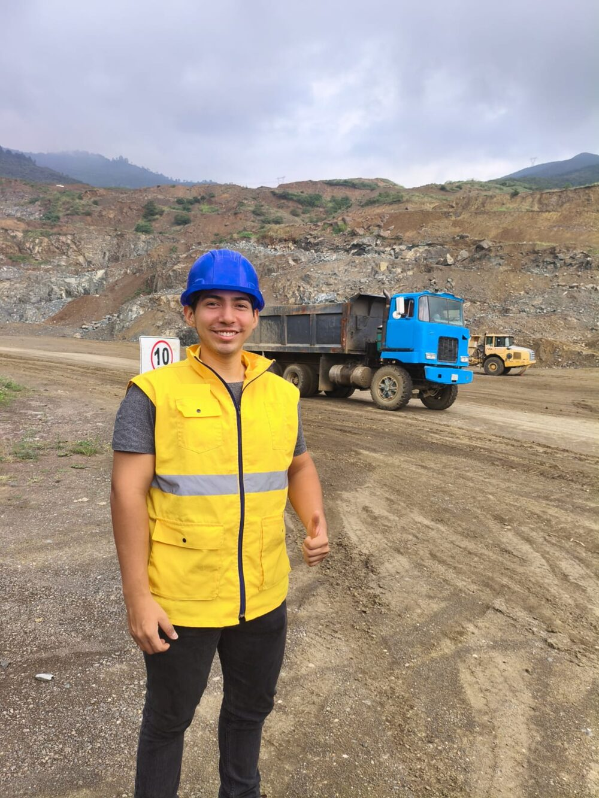
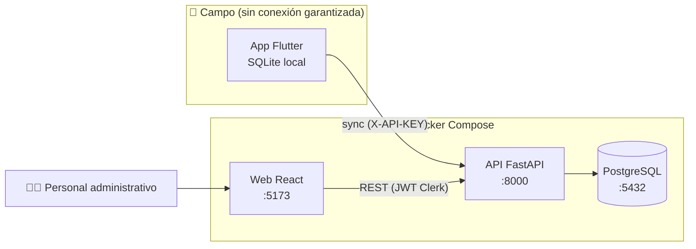

<div align="center">

# 🛞 Digitalización de Inspecciones de Llantas

**Sistema offline-first para registrar en campo el estado de las llantas de equipos industriales y agrícolas, con sincronización a una API central y una plataforma web de administración.**


[](https://github.com/juanerv1/digitalizacion-inspecciones/actions/workflows/ci.yml)


### ▶️ Demo en video

[](https://youtu.be/WKXFmAAf3YM)

<sub>Recorrido completo: preparar datos en la web, inspeccionar sin conexión en la app y ver el resultado en la plataforma.</sub>

</div>

---

## 📌 Visión general

### El problema

Una empresa comercializadora de llantas del sector agroindustrial hacía sus inspecciones de campo **en papel**. Los inspectores recorrían fincas, ingenios y patios industriales anotando llanta por llanta la presión, el desgaste y las observaciones de cada equipo. Al volver a la oficina, alguien tenía que **reescribir a mano** esos datos en la base de datos de la empresa.

Ese proceso traía problemas concretos:

- **Doble digitación**: el mismo dato se escribía dos veces, con el costo de horas de trabajo que eso implica.
- **Errores de transcripción**: letra ilegible, cifras invertidas, hojas perdidas o mojadas en campo.
- **Historial poco accesible**: el inspector no tenía a mano los datos de la inspección anterior del mismo equipo, así que no podía comparar el desgaste en el momento.
- **Retraso en los reportes**: los informes para el cliente final dependían de que terminara la transcripción.

### La solución

Un sistema de tres piezas que lleva el dato **desde el campo hasta la base de datos sin pasar por el papel**:

| Componente | Tecnología | Función |
|---|---|---|
| 📱 **App móvil** | Flutter + SQLite (Drift) | El inspector elige cliente y vehículo, y registra llanta por llanta. Funciona **sin conexión** y sincroniza cuando hay señal. |
| ⚙️ **API REST** | FastAPI + PostgreSQL | Recibe las inspecciones de la app, procesa cargas masivas por CSV y genera reportes en Excel. |
| 🖥️ **Plataforma web** | React + TypeScript | El personal administrativo gestiona clientes, carga el historial y consulta o descarga las inspecciones. |

### Beneficios

- ✅ **Se elimina la doble digitación**: el dato se captura una sola vez, en el lugar de la inspección.
- ✅ **Funciona en zonas rurales** gracias a la arquitectura *offline-first* con sincronización asíncrona.
- ✅ **Historial en campo**: el inspector ve la última inspección de cada equipo antes de registrar la nueva.
- ✅ **Datos validados y estructurados** desde el origen, listos para reportes.
- ✅ **Reportes inmediatos** en Excel, por inspección y como *kardex* de la flota completa.

---

## 👨‍💻 Experiencia de desarrollo

Fui el **único desarrollador** del proyecto y me encargué de todo su ciclo de vida: levantamiento de requerimientos, diseño de la arquitectura, desarrollo de las tres aplicaciones, despliegue y capacitación.

- **Requerimientos con el cliente**: hice reuniones periódicas con la empresa para definir los requerimientos funcionales y priorizar cada entrega.
- **Trabajo de campo**: acompañé al equipo de inspectores en sus recorridos para entender las necesidades operativas reales. De ahí salieron decisiones clave: la conectividad intermitente obligó al diseño *offline-first*, y el registro llanta por llanta se ajustó al orden físico de los equipos.
- **Metodología evolutiva**: el sistema creció por entregas incrementales. Después de cada una capacitaba a los inspectores en el uso de la app y recogía retroalimentación para la siguiente iteración.


### 📸 En campo

<table>
  <tr>
    <td width="62%" align="center">
      
    </td>
    <td width="38%" align="center">
      
    </td>
  </tr>
  <tr>
    <td align="center"><sub>El equipo de inspectores durante la revisión de un vehículo. Observar el proceso real permitió diseñar la app alrededor de cómo trabajan.</sub></td>
    <td align="center"><sub>Acompañando al equipo en la zona de operación para probar la aplicación en condiciones reales.</sub></td>
  </tr>
</table>

---

## ✨ Funcionalidades principales

### 🖥️ Módulo web (administración)

- **Autenticación** de usuarios administrativos con Clerk.
- **Gestión de clientes**: creación, búsqueda y filtrado por sede.
- **Carga masiva por CSV**: se sube el archivo de una inspección y el sistema crea o actualiza automáticamente vehículos, llantas y catálogos (marcas, tipos, diseños y dimensiones).
- **Preparación del historial**: los datos cargados quedan disponibles para que la app móvil los descargue como referencia.
- **Consulta de inspecciones**: vista previa del detalle por vehículo y por llanta.
- **Exportación a Excel**: reporte de una inspección y *kardex* de la flota completa del cliente.

### 📱 Módulo móvil (campo)

- **Flujo guiado de inspección**: cliente → vehículo → llanta por llanta.
- **Registro por llanta**: presión (PSI), profundidad de labrado (exterior, centro, interior), código, marca, diseño, dimensión, fecha de montaje y observaciones.
- **Datos por vehículo**: horómetro y kilometraje.
- **Consulta del historial**: muestra la última inspección registrada de cada equipo.
- **Almacenamiento local** en SQLite: todo se guarda en el dispositivo mientras se trabaja.
- **Sincronización asíncrona**: el inspector decide cuándo enviar y descargar datos, normalmente al recuperar conexión.
- **Gestión de inspecciones**: inspecciones pendientes, finalizadas y eliminación en cascada.
- **Configuración del servidor** (URL y API Key) desde la propia app.

---

## 🚀 Inicio rápido

> Requisitos: **Git** y **Docker** con **Docker Compose**. La guía completa, con la instalación de la app Android, está en **[docs/DEPLOYMENT.md](docs/DEPLOYMENT.md)**.

```bash
git clone https://github.com/juanerv1/digitalizacion-inspecciones.git
cd digitalizacion-inspecciones
cp .env.example .env
docker compose up -d
```

| Servicio | URL |
|---|---|
| Plataforma web | http://localhost:5173 |
| API (Swagger) | http://localhost:8000/docs |
| PostgreSQL | `localhost:2000` |

### 🔑 Credenciales de demostración

| Recurso | Valor |
|---|---|
| Usuario web (Clerk) | `invitado` |
| Contraseña web | `digitalizacion_password_2026` |
| API Key de la app móvil | `qU95h358WTPcGWzEcPMgt` |
| Archivo CSV de prueba | [`csv_files/ejemplo_inspeccion.csv`](csv_files/ejemplo_inspeccion.csv) |

> ⚠️ Estas credenciales son **solo para demostración local**. En un entorno real deben reemplazarse por valores secretos.

---

## 🧪 Probar el flujo completo

1. Entra a la web con el usuario `invitado` y **crea un cliente**.
2. Selecciónalo y usa **"Subir Inspección"** con el archivo [`csv_files/ejemplo_inspeccion.csv`](csv_files/ejemplo_inspeccion.csv): 8 equipos y 32 llantas con datos ficticios.
3. Revisa la vista previa y **descarga el Excel** o el *kardex* de flota.
4. Instala el **APK**, configura la URL del servidor y la API Key, y **sincroniza**: el cliente y su historial aparecen en el teléfono.
5. Haz una inspección nueva en la app (puede ser en modo avión), **finalízala y sincroniza**.
6. Vuelve a la web: la nueva inspección ya aparece en el listado del cliente.

---

## 🏗️ Arquitectura



El detalle de componentes, el flujo de sincronización, el modelo de datos y los endpoints están en **[docs/ARCHITECTURE.md](docs/ARCHITECTURE.md)**.

---

## 🧪 Pruebas

**134 pruebas automatizadas** (84 del backend y 50 de la app móvil) corren en GitHub Actions en cada *push*, junto con el análisis estático de Flutter y la compilación del frontend.

```bash
# Backend (con Docker, sin instalar Python)
docker compose run --rm --no-deps -v ./csv_files:/csv_files backend python -m pytest

# App móvil (requiere Flutter)
cd mobile && flutter test
```

Cubren la seguridad de los endpoints, la carga masiva por CSV, la sincronización (idempotencia, rollback ante datos inconsistentes, descarga incremental), las consultas SQL de la base local y las pantallas principales. El detalle está en **[docs/TESTING.md](docs/TESTING.md)**.

---

## 📁 Estructura del repositorio

```
digitalizacion-inspecciones/
├── backend/            # API FastAPI + SQLAlchemy + Alembic
│   ├── api/            # Routers: web (Clerk), mobile (API Key), seguridad
│   ├── crud/           # Lógica de negocio (web, sincronización app, utilidades)
│   ├── db/             # Modelos y sesión de base de datos
│   ├── schemas/        # Esquemas Pydantic
│   ├── alembic/        # Migraciones de base de datos
│   └── test/           # Pruebas con pytest (API, CSV, sincronización, seguridad)
├── frontend/           # Plataforma web React + TypeScript (Vite)
│   └── src/
│       ├── components/ # Dashboard, sidebar, modales
│       └── services/   # Cliente HTTP (axios) y tipos
├── mobile/             # App Flutter
│   ├── lib/
│   │   ├── core/       # Cliente HTTP y configuración de la API
│   │   ├── data/db/    # Base de datos local (Drift): tablas y DAOs
│   │   ├── models/     # Entidades y DTOs
│   │   ├── services/   # Sincronización e inyección de dependencias
│   │   └── ui/         # Pantallas y paleta de colores
│   └── test/           # Pruebas: modelos, base local, sincronización, UI
├── csv_files/          # Archivo CSV de ejemplo para la carga masiva
├── docs/               # Arquitectura, despliegue y pruebas
├── .github/workflows/  # Integración continua (GitHub Actions)
├── docker-compose.yml
└── .env.example
```

---

## 📈 Estado del proyecto y futuras mejoras

**Estado:** ✅ **Versión final entregada al cliente.** Es el resultado de un desarrollo progresivo por entregas.

Estaba planificada una **Fase 2** para optimizar funcionalidades y revisar algunas decisiones de arquitectura, pero el proyecto no continuó. Estas eran las mejoras proyectadas:

| Área | Mejora proyectada |
|---|---|
| 🔐 Seguridad móvil | Reemplazar la API Key compartida por autenticación por usuario (tokens por inspector) y guardar las credenciales con almacenamiento seguro. |
| 🔄 Sincronización | Aplicar en la descarga el límite de 6 meses de historial (está previsto en la API pero aún no se aplica), sincronización automática en segundo plano al detectar conexión, con reintentos y resolución de conflictos más granular. |
| 📥 Carga de datos | Validación previa del CSV con reporte de errores por fila antes de insertar, y soporte para archivos Excel. |
| 📊 Analítica | Dashboard con indicadores de desgaste, alertas de presión y proyección de vida útil por llanta. |
| 🧪 Calidad | Pruebas end-to-end contra PostgreSQL real, tests de las pantallas de inspección y versiones fijas de todas las dependencias. |
| 🚢 Despliegue | Imágenes de producción (build estático del frontend con nginx) y despliegue en la nube con HTTPS. |
| 📱 App | Captura de fotos de daños por llanta y lectura de códigos de llanta con la cámara. |

---

<div align="center">

Desarrollado de principio a fin por un único desarrollador · Proyecto de portafolio

</div>
