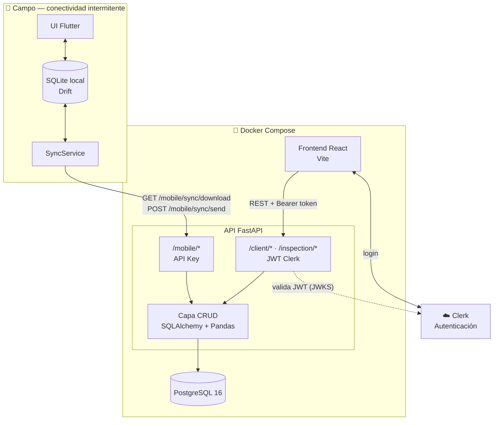
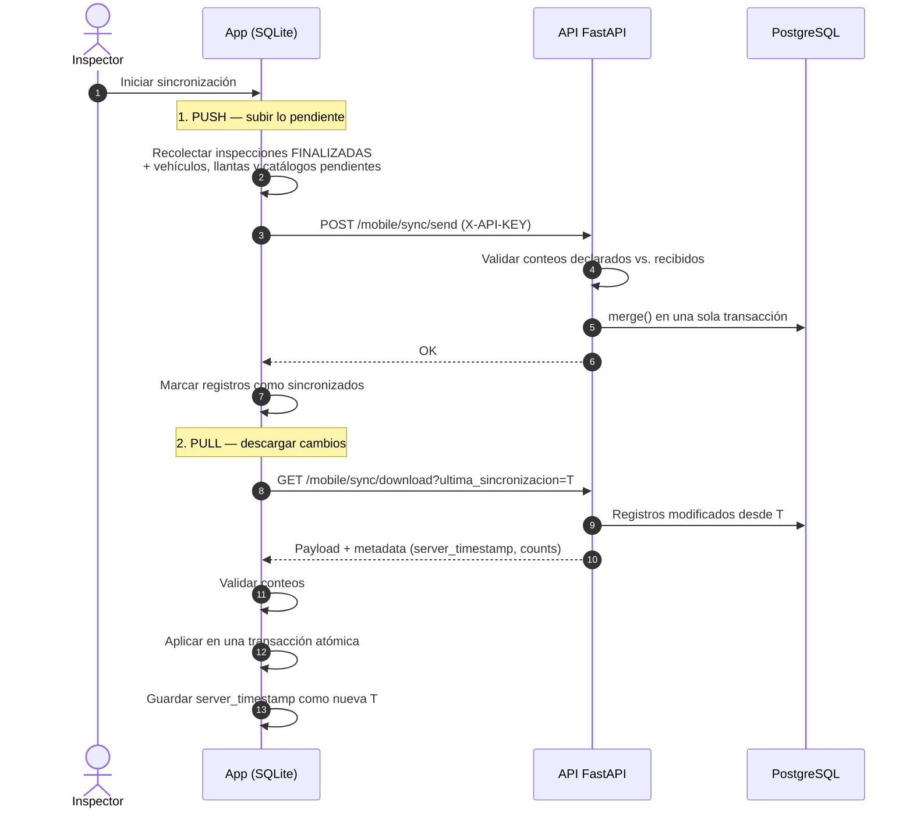
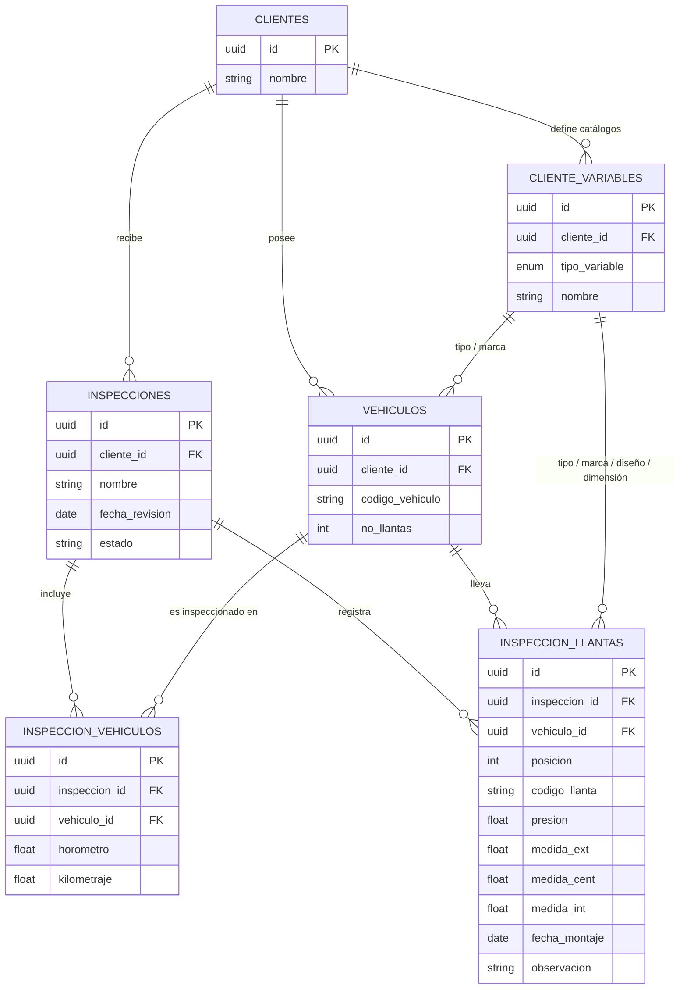

# 🏗️ Arquitectura del sistema

Este documento describe los componentes del sistema, cómo se comunican y las decisiones técnicas detrás del diseño.

---

## 1. Vista general



| Capa | Tecnología | Responsabilidad |
|---|---|---|
| App móvil | Flutter, Drift (SQLite), `http`, `get_it` | Captura offline de inspecciones y sincronización |
| API | FastAPI, SQLAlchemy 2.0, Pydantic, Pandas, Alembic | Reglas de negocio, sincronización, carga CSV, reportes Excel |
| Base de datos | PostgreSQL 16 | Fuente de verdad central |
| Web | React 19, TypeScript, Vite, Axios | Administración de clientes, cargas y reportes |
| Autenticación web | Clerk | Login de usuarios administrativos y emisión de JWT |
| Infraestructura | Docker Compose | Orquestación local de los tres servicios |

---

## 2. Decisión clave: offline-first con sincronización asíncrona

Las inspecciones se hacen en zonas rurales e industriales **sin conectividad garantizada**. Por eso la app no depende de la red para trabajar:

- **Toda la operación ocurre sobre la base local** (SQLite con Drift). El inspector crea, edita y finaliza inspecciones sin conexión.
- **La sincronización es explícita**: el inspector la lanza cuando tiene señal, normalmente al terminar la jornada.
- **Identificadores UUID** generados en el dispositivo: los registros creados offline no colisionan con los del servidor ni con los de otros dispositivos.
- **Marcas de sincronización**: cada registro local indica si está pendiente de envío, lo que permite enviar solo lo nuevo.

### 2.1 Flujo de sincronización



### 2.2 Garantías de integridad

| Mecanismo | Dónde | Propósito |
|---|---|---|
| **Conteos declarados** en `metadata.counts` | Subida y descarga | Detectar registros descartados en silencio al serializar o deserializar. Si los números no cuadran, se aborta. |
| **Transacción única** | API (`procesar_sincronizacion_app`) | Si falla cualquier registro se hace *rollback* total: no quedan inspecciones huérfanas. |
| **Transacción atómica en Drift** | App (`syncPull`) | Una descarga parcial nunca se guarda y la fecha de última sincronización no avanza. |
| **Timestamp del servidor** | App | La sincronización incremental usa el reloj del servidor, no el del teléfono, para evitar desfases horarios. |
| **Solo inspecciones finalizadas** | App (`enviarDatosAlServidor`) | Las inspecciones en curso no se envían hasta que el inspector las cierra. |
| **`merge()` (upsert)** | API | Reenviar los mismos datos es idempotente: no genera duplicados. |

---

## 3. Backend (FastAPI)

```
backend/
├── main.py              # App FastAPI, CORS, /health y registro de routers
├── api/
│   ├── web.py           # Endpoints de administración (protegidos con Clerk)
│   ├── mobile.py        # Endpoints de sincronización (protegidos con API Key)
│   └── security.py      # Validación de API Key y de JWT de Clerk
├── crud/
│   ├── web/             # Clientes, vehículos, inspecciones y reportes (CSV/Excel)
│   ├── app/sync.py      # Lógica de subida y descarga para la app
│   └── utils/helpers.py # Normalización de fechas y números
├── db/                  # Modelos SQLAlchemy y sesión
├── schemas/             # Esquemas Pydantic (request/response)
├── alembic/             # Migraciones versionadas
└── test/                # Pruebas con pytest (SQLite temporal) — ver TESTING.md
```

### 3.1 Dos esquemas de autenticación

| Consumidor | Mecanismo | Implementación |
|---|---|---|
| Plataforma web | **JWT de Clerk** en `Authorization: Bearer` | `verificar_token`: descarga las JWKS de `CLERK_ISSUER` y valida firma RS256 y emisor |
| App móvil | **API Key** en `X-API-KEY` | `get_api_key`: compara con `API_KEY_SECRET` |

Se separaron porque los consumidores son distintos: el personal administrativo inicia sesión con usuario propio, mientras que la app opera en dispositivos de campo con una credencial de servicio.

### 3.2 Endpoints

**Administración — requieren JWT de Clerk**

| Método | Ruta | Descripción |
|---|---|---|
| `POST` | `/client/` | Crear cliente |
| `GET` | `/client/` | Listar clientes |
| `GET` | `/client/{id}` | Detalle de cliente |
| `PATCH` | `/client/{id}` | Editar cliente |
| `GET` | `/client/{id}/variables/vehicle-form` | Catálogos del cliente para formularios |
| `GET` | `/client/{id}/vehiculos` | Listar vehículos |
| `POST` | `/client/{id}/vehiculos` | Crear vehículo |
| `PUT` | `/client/{id}/vehiculos/{vehiculo_id}` | Actualizar vehículo |
| `POST` | `/inspection/` | **Carga masiva**: `multipart/form-data` con `cliente_id`, `nombre`, `fecha_revision` y `file` (CSV) |
| `GET` | `/inspection/client/{cliente_id}` | Resumen de inspecciones del cliente |
| `GET` | `/inspection/{id}/preview` | Detalle de una inspección |
| `GET` | `/inspection/{id}/excel` | Exportar inspección a Excel |
| `GET` | `/inspection/kardex/{cliente_id}/excel` | Kardex de la flota del cliente |

**Sincronización móvil — requieren `X-API-KEY`**

| Método | Ruta | Descripción |
|---|---|---|
| `GET` | `/mobile/sync/download` | Cambios desde `ultima_sincronizacion` (ISO 8601). Admite filtrar por `cliente_id` |
| `POST` | `/mobile/sync/send` | Recibe el payload `AppSyncPayload` con los registros pendientes |

**Público**

| Método | Ruta | Descripción |
|---|---|---|
| `GET` | `/health` | Estado del servicio |
| `GET` | `/docs` | Documentación Swagger generada por FastAPI |

### 3.3 Carga masiva por CSV

`procesar_kartex_pandas` (`crud/web/reporteWeb.py`) convierte el CSV en registros relacionales:

1. Crea la inspección con estado `FINALIZADO`.
2. Lee el archivo con Pandas, detecta el separador y hace *fallback* de codificación (UTF-8 → Latin-1).
3. Normaliza los encabezados (tildes, espacios, `Diseño` → `Diseno`) y rellena los nulos de las columnas clave.
4. Agrupa por equipo y, para cada uno, busca o crea el **vehículo** y registra la inspección del vehículo (horómetro y kilometraje).
5. Por cada llanta, resuelve los **catálogos dinámicos** (tipo, marca, diseño, dimensión) y registra la inspección de la llanta. Si no trae código, se genera uno determinístico.
6. Todo ocurre en una transacción: si una fila falla, no se guarda nada.

### 3.4 Catálogos dinámicos por cliente

En lugar de tablas fijas de marcas o tipos, cada cliente tiene su propio catálogo en `cliente_variables`, clasificado con `TipoVariableEnum` (tipo y marca de vehículo; tipo, marca, diseño y dimensión de llanta). Los valores nuevos se crean al vuelo durante la carga CSV o desde la app. Así cada cliente conserva su propia nomenclatura sin depender de un catálogo global.

---

## 4. Modelo de datos



- Todas las relaciones usan **`ON DELETE CASCADE`**: eliminar una inspección borra sus vehículos y llantas inspeccionados.
- Una restricción de unicidad (`inspeccion_id`, `vehiculo_id`) en `inspeccion_vehiculos` impide registrar dos veces el mismo vehículo dentro de una inspección.
- La app replica este mismo esquema en SQLite (`mobile/lib/data/db/tables.dart`), más una tabla `SyncData` con la fecha de la última sincronización.
- El esquema del servidor se versiona con **Alembic**: las migraciones se aplican automáticamente al arrancar el contenedor.

---

## 5. App móvil (Flutter)

```
mobile/lib/
├── main.dart                 # Arranque, tema global y navegación inferior
├── core/network/api_client.dart  # Cliente HTTP + configuración (URL, API Key)
├── data/db/                  # Drift: tablas, DAOs y código generado
├── models/                   # Entidades de dominio y DTOs de sincronización
├── services/
│   ├── service_locator.dart  # Inyección de dependencias (get_it)
│   └── sync_service.dart     # Push y pull de la sincronización
└── ui/
    ├── app_colors.dart       # Paleta compartida con la web
    └── Views/                # Pantallas
```

| Patrón | Uso |
|---|---|
| **Repositorio local (DAOs de Drift)** | Toda la UI lee y escribe contra SQLite, nunca contra la red |
| **Streams reactivos** | Las pantallas se suscriben con `watch...()` y se actualizan solas al cambiar los datos |
| **Service Locator (`get_it`)** | Un único acceso a `AppDatabase`, `ApiClient` y `SyncService` |
| **Configuración persistente** | La URL y la API Key se guardan con `shared_preferences` y se editan desde la app |

**Pantallas principales**

| Pantalla | Función |
|---|---|
| Inspecciones pendientes | Inspecciones en curso, con opciones para finalizar o eliminar |
| Clientes | Directorio con búsqueda, filtro por sede y acceso a la sincronización |
| Detalle de cliente | Historial de inspecciones del cliente y creación de una nueva |
| Inspección en proceso | Vehículos de la inspección y su avance (inspeccionado o pendiente) |
| Detalle de vehículo | Registro llanta por llanta, con referencia de la última medición |
| Inspección finalizada | Consulta de solo lectura de inspecciones cerradas |

---

## 6. Frontend web (React)

```
frontend/src/
├── main.tsx              # ClerkProvider y pantalla de login
├── App.tsx               # Layout, carga de clientes y configuración de Axios
├── services/api.ts       # Instancia de Axios, interceptor del token y tipos
└── components/
    ├── Navbar.tsx            # Barra superior y cierre de sesión
    ├── Sidebar.tsx           # Lista de clientes, búsqueda y filtro por sede
    ├── ClientDashboard.tsx   # Estadísticas, vehículos, inspecciones y descargas
    ├── CreateClientModal.tsx
    ├── UploadInspectionModal.tsx
    └── PreviewInspection.tsx
```

Un **interceptor de Axios** obtiene el token de la sesión de Clerk en cada petición y lo agrega como `Authorization: Bearer <token>`. Así ningún componente tiene que manejar la autenticación por su cuenta.

---

## 7. Infraestructura (Docker Compose)

| Servicio | Imagen | Puerto | Notas |
|---|---|---|---|
| `database` | `postgres:16` | `2000:5432` | Volumen `pgdata` persistente y *healthcheck* con `pg_isready` |
| `backend` | build de `./backend` (Python 3.11) | `8000` | Espera a que la BD esté saludable, aplica migraciones y arranca Uvicorn |
| `frontend` | `node:22-alpine` | `5173` | Servidor de desarrollo de Vite; `node_modules` en un volumen aparte |

Todos los servicios leen su configuración del archivo `.env` de la raíz (ver [`.env.example`](../.env.example)).
